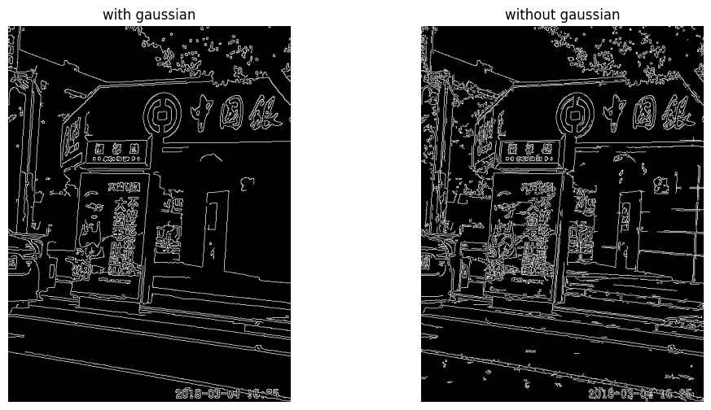
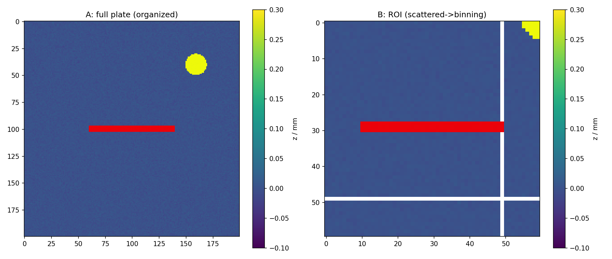
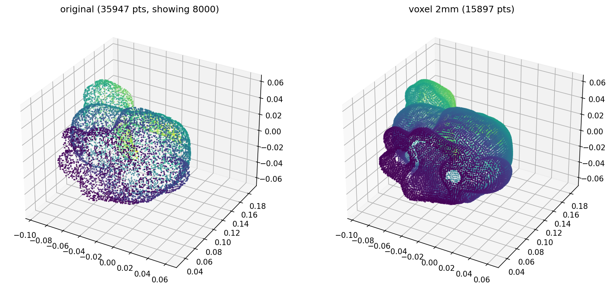
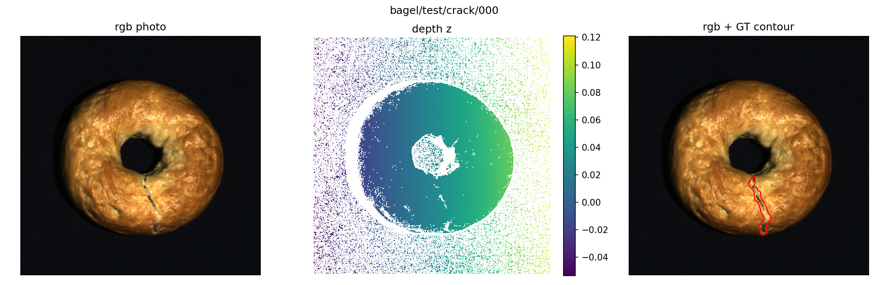
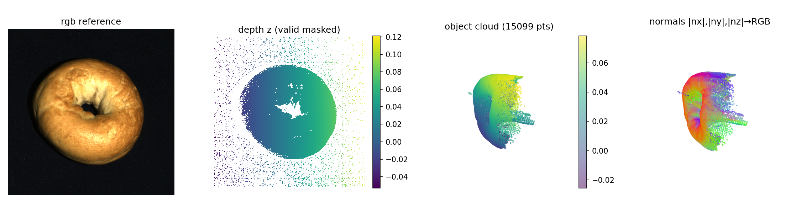

# 3d-vision-basics

Learning repo: industrial 3D vision inspection + edge AI + embodied perception.
Stage 1: 3D vision basics —— 从 2D 图像基础到 3D 点云质检最小闭环。
Stage 2: 论文复现线 —— MVTec 3D-AD 数据集上复现 Real3D-AD / Reg3D-AD 路线（三篇论文精读笔记见 [docs/三篇论文精读详解.md](docs/三篇论文精读详解.md)）。


带练进度：Day 1 环境搭建 ✅ → Day 2 数字图像基础 ✅ → Day 3 点云质检流水线 ✅ → Day 4 真实数据集 ✅ → Day 5 点云配准 ICP（待开工）

复现线：阶段 0 数据集就位 ✅ → 阶段 1 数据探查 ✅（任务 1-5）→ 阶段 2 BTF 简化版（任务 1-3 ✅，任务 4 全测试集评测已就绪）→ 阶段 3 Reg3D-AD 完整版（待开工）→ 观察题：2.5D 盲区 vs 3D 分数差

## 成果预览

| Day 2 · Canny 边缘 | Day 3 · 缺陷检测 | Day 4 · 体素降采样 |
| :-: | :-: | :-: |
|  |  |  |
| 高斯平滑：外置 vs 内生对照 | 双阈值分割划痕/凸起（像素→mm²） | Stanford Bunny 35947 → 15897 点 |

| 阶段 1 · GT 轮廓叠加 | 阶段 2 · FPFH 初接触 |
| :-: | :-: |
|  |  |
| rgb 照片 + GT 轮廓对齐验证 | 平面剥离 → voxel → 法线 → 33 维指纹 |

## 目录结构

### `day02/` — 数字图像基础（OpenCV / NumPy / Matplotlib）

- `ex1_convolution.py` 手写卷积 + 诊断行；`ex1_vectorized.py` 向量化加速版（sliding_window_view + einsum，~147×）
- `ex2_edge.py` Canny 边缘提取 + 高低阈值对照实验
- `ex3_heightmap.py` 高度图可视化（伪彩色 / vmin-vmax 对照 / 3D 曲面）
- `ex4_fileio.py` 图像文件 IO（JPEG/PNG/npy 保真对比 + 标注画框）
- `ex5_homogeneous.py` 附加题：2D 齐次坐标刚体变换（直通 3D 4×4 外参）
- `ex*_*.png` 各练习交付图（入库）；`ex4_output/` 运行产物（可再生，已 gitignore）

### `day03/` — 点云质检全流程（Open3D + NumPy）

- `ex1_formats.py` 点云本质 + 4 种格式读写（npy/pcd/ply/xyz）；生成合成金属板 `plate.*`（seed 42，确定性可复现）
- `make_tiny_pcd.py` 生成 tiny.pcd，用于 pcd header 逐行解剖
- `ex2_pipeline.py` 预处理流水线：ROI 裁剪 → 体素降采样(0.1mm) → 统计滤波(k=20)，落盘 `clean_pts.npy`（40800→14475→3810→3735）
- `ex3_heightmap.py` 点云→高度图双路线：有组织 reshape vs 散点 mean binning（60×60，空格=NaN）
- `ex4_defect_detect.py` 双阈值缺陷检测（划痕 z<-0.05 / 凸起 z>0.08），像素→mm² 换算 + NG 判定
- `ex*_*.png` 交付图（入库）
- 数据产物（`plate.*` / `clean_pts.npy` / `heightmap.npy`，脚本可再生）已 gitignore

### `day04/` — 真实数据集：Stanford Bunny

- `ex1_bunny_to_pcd.py` 三角网格→点云：下载校验 → 顶点/面片体检 → 面积加权均匀采样 200 点 → 数学不变量断言 → npy+pcd 双落盘
- `make_bunny_full.py` 网格顶点全量落盘 `bunny_full.ply`（ex2 的输入，确定性可再生）
- `ex2_bunny_preprocess.py` 真实数据预处理：bbox 尺度体检 → voxel_size 三档扫描（1/2/5mm → 34583/15897/3023 点）→ 2mm 定稿 + 统计滤波（-394）→ npy 落盘
- `ex3_bunny_normals.py` 法线估计（knn=30 PCA）+ 一致性定向 + 法线着色可视化 + RANSAC 平面分割（真实曲面内点率 ~10% vs 合成平板）
- `ex4_bunny_defect.py` Day 4 收官闭环：真值法线注入压痕（抛物线 punch 轮廓）→ RaycastingScene 点到网格比对 → 检出率/精确率（47.31%/100%，阈值 1.5mm 卡噪声底与信号空档）
- 数据产物（`bunny_*.npy/pcd/ply`，脚本可再生）已 gitignore

### `repro/` — 论文复现线（MVTec 3D-AD → Reg3D-AD）

数据集前置：MVTec 3D-AD 解压到 `/mnt/e/datasets/mvtec3d/`（10 类，4147 张 xyz tiff；脚本内 `ROOT` 可改）。

- `stage01_data_explore/` 阶段 1 数据探查（任务 1-5 全收官）：
  - `ex01_structure_scan.py` 结构普查：train 2656 / test 1197 与 GT 逐类对账，4147 总量一致 → `ex01_structure_scan.csv`
  - `ex02_format_probe.py` 格式探查：float32 米制坐标；**坏点是全零 (0,0,0) 不是 NaN**（np.isnan 滤不掉）；8-bit 截断模拟"无声失败"教学点
  - `ex03_visualize.py` bagel 四联张 + 俯视投影：坏点掩码、伪彩 1%/99% 分位卡色标
  - `ex04_gt_alignment.py` GT 编码解读（combined = 多灰度叠加）+ 轮廓叠加对齐验证 + 全类缺陷占比统计 → **10 类平均缺陷像素占比 0.47%**（异常检测"罕见事件"方法论根源）
  - `ex05_plane_tilt.py` 背景平面倾角多样本再核：边缘环带采样 vs 全图拟合对照 → **相机 ~7° 掠射角**（法线与视轴夹角 83°）、3D 网格各向异性（x 步 0.05mm / y 步 0.195mm）、姿态每类固定（同类极差 ≤0.12°）——阶段 2"去背景再建库"的设计依据
- `stage02_btf_baseline/` 阶段 2 BTF 简化版（FPFH + 记忆库 + kNN）：
  - `ex01_fpfh_first_contact.py` FPFH 初接触：平面剥离（距背景平面 >10mm）→ voxel 1mm → 法线 → 33 维指纹；特征质量"局部性检验"（近邻对 vs 随机对 5.67×，Spearman ρ=0.713）
  - `ex02_memory_bank.py` 记忆库：bagel 前 30 张 train/good → 479344×33 float32（60MB，已 gitignore）；法线"朝相机"全局朝向约定（跨图可比）
  - `ex03_knn_retrieval.py` kNN 检索：6 查询双统计量（score_mean / score_top1%）完全分离；contamination 几何盲区实证
  - `ex04_eval_auroc.py` 全测试集评测：bagel 110 张，手写秩法 AUROC，双统计量对决 + 分数分布图
- 数据产物（`*.npy` / `*.csv` 中的大数据）按"可再生"原则 gitignore

## 复跑顺序（依赖链，缺产物就从第一步补）

### 复现线 stage02（需数据集；先 ex02 建库，后 ex03/ex04 检索评测）

```bash
conda activate industrial3d
cd repro/stage02_btf_baseline
python ex01_fpfh_first_contact.py   # 单张图 FPFH 验收 → 四联张 PNG（~10s）
python ex02_memory_bank.py          # 建库 → bank.npy（~10s，60MB）
python ex03_knn_retrieval.py        # 6 查询双统计量快检（~17s）
python ex04_eval_auroc.py           # bagel 全测试集 110 张 AUROC 对决（~5min）
```

### 复现线 stage01（纯探查，只读数据集，各自独立）

```bash
conda activate industrial3d
cd repro/stage01_data_explore
python ex01_structure_scan.py
python ex02_format_probe.py
python ex03_visualize.py
python ex04_gt_alignment.py
python ex05_plane_tilt.py
```

### Day 4（首跑需联网下载 BunnyMesh，之后走 `~/open3d_data/` 缓存）

```bash
conda activate industrial3d
cd day04
python ex1_bunny_to_pcd.py      # BunnyMesh → bunny_pts.npy / bunny.pcd（200 点采样）
python make_bunny_full.py       # BunnyMesh 顶点全量 → bunny_full.ply（ex2 输入）
python ex2_bunny_preprocess.py  # bunny_full.ply → 体素降采样+统计滤波 → bunny_down/clean.npy
python ex3_bunny_normals.py     # bunny_clean.npy → ex3_normals_ransac.png（法线着色+RANSAC）
python ex4_bunny_defect.py      # bunny_clean.npy → ex4_defect_result.png（注入+CAD比对+两率）
```

### Day 3

```bash
conda activate industrial3d
cd day03
python ex1_formats.py        # 生成 plate.{npy,pcd,ply,xyz}
python ex2_pipeline.py       # plate.pcd → clean_pts.npy
python ex3_heightmap.py      # clean_pts.npy → heightmap.npy
python ex4_defect_detect.py  # plate.npy + heightmap.npy → ex4_defect.png
```

## 运行环境

WSL2 Ubuntu + conda 环境 `industrial3d`（Python 3.10 / PyTorch 2.1.2+cu121 / Open3D 0.18.0 / OpenCV 4.8.1 / NumPy 1.24.3 / Matplotlib 3.7.2 / SciPy 1.15.3）。

WSL 无显示器：所有图一律 `plt.savefig()`，用 `explorer.exe xxx.png` 查看。
